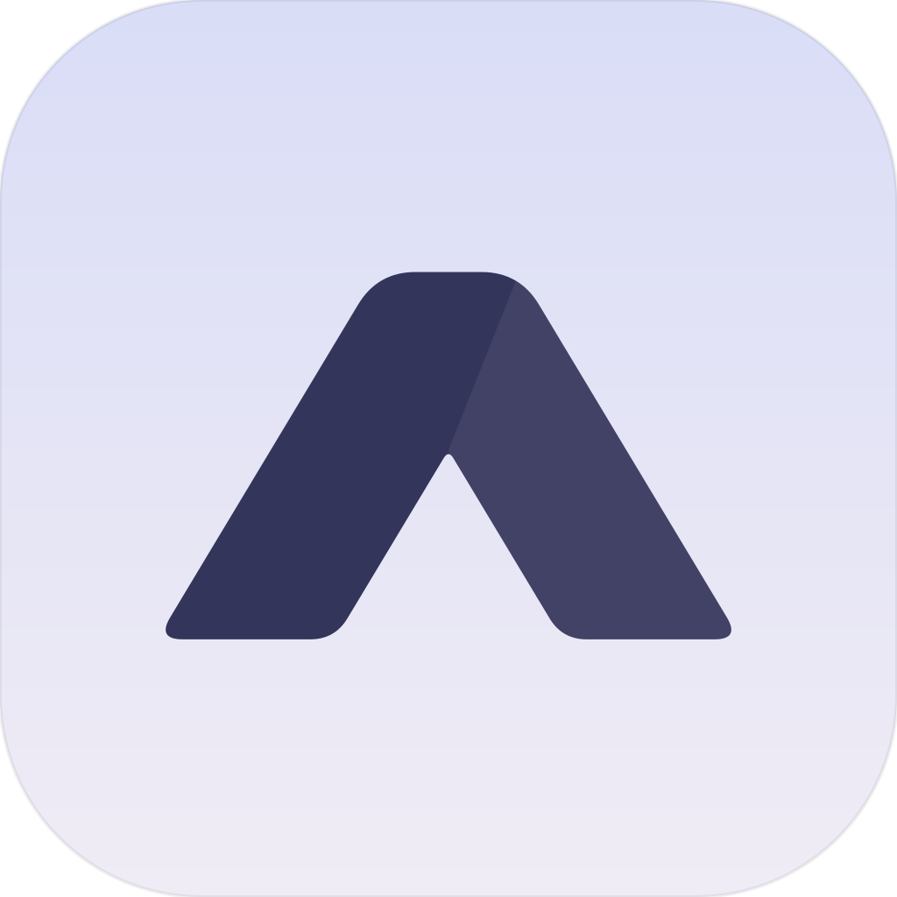
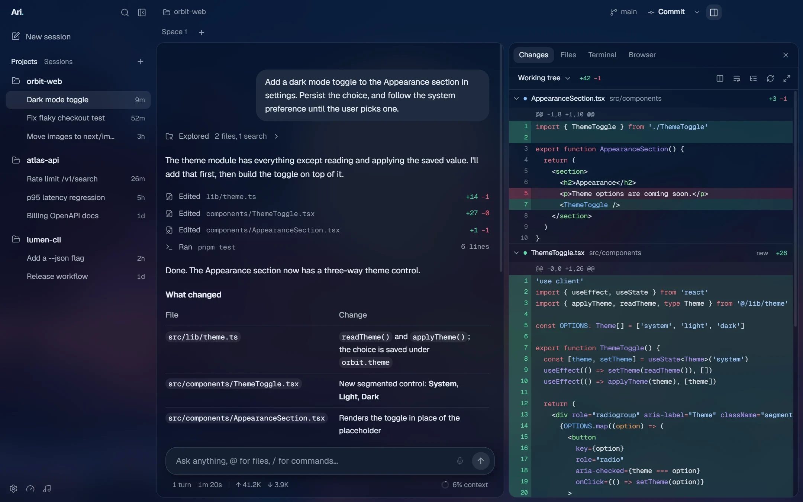
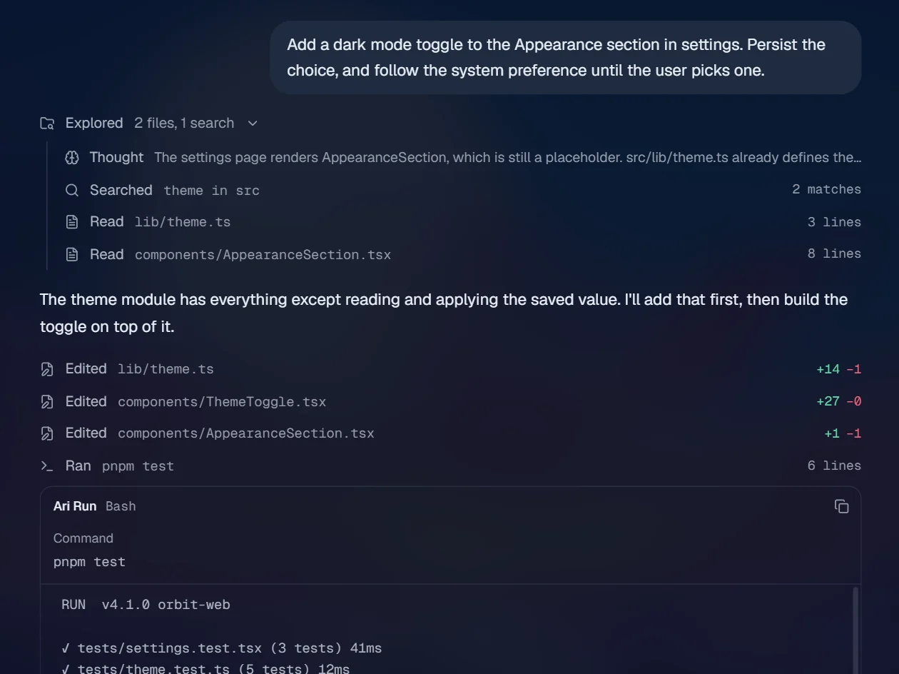
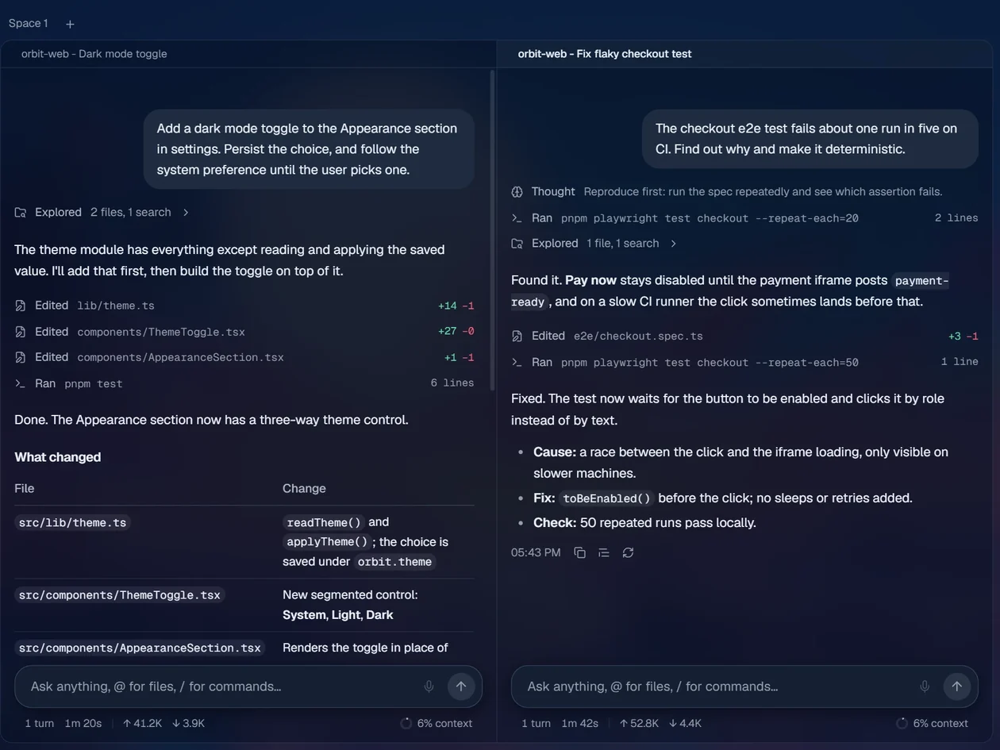
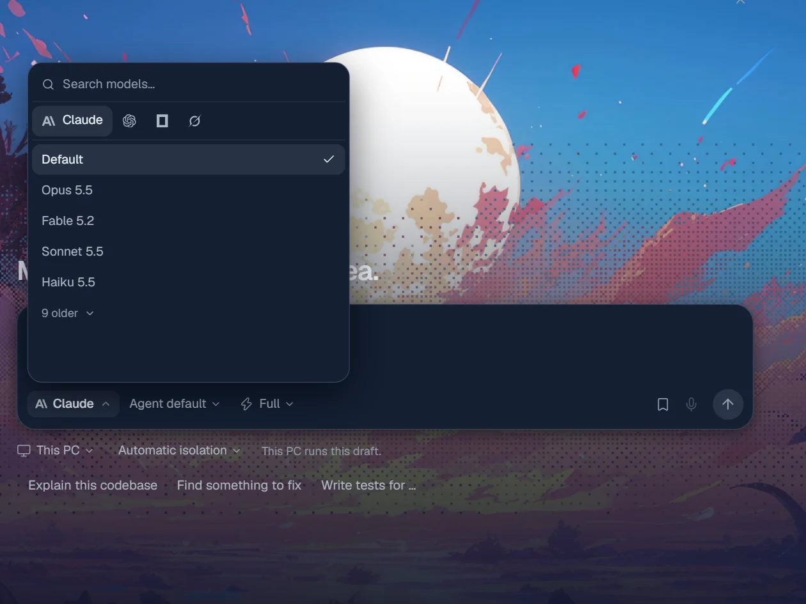
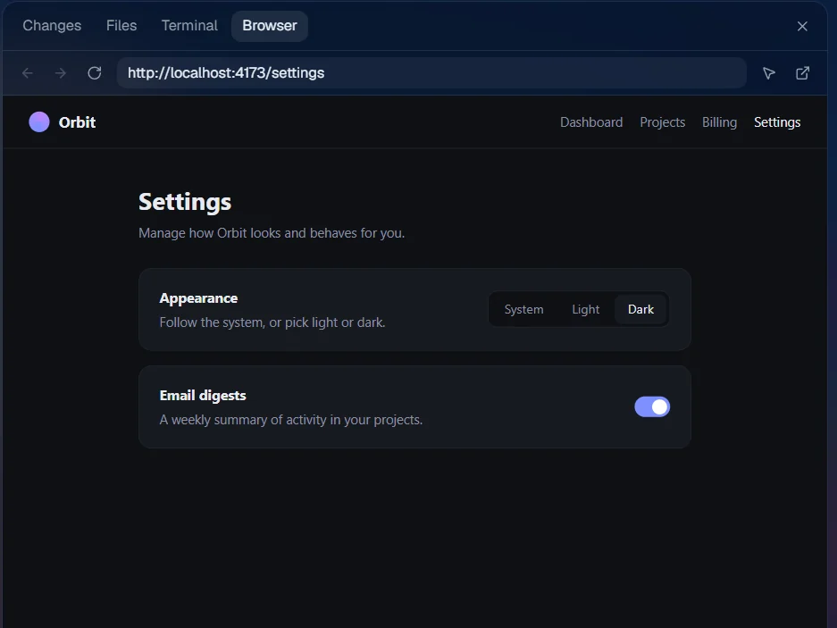
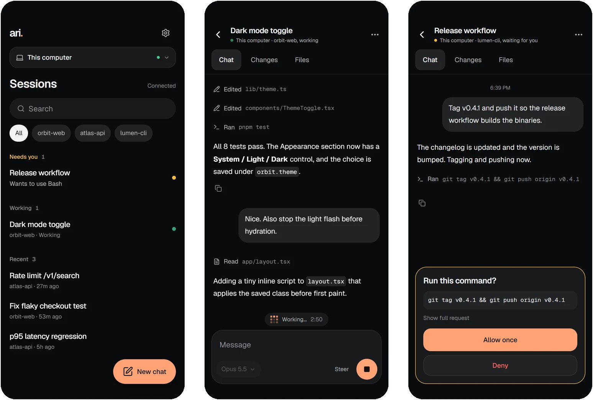
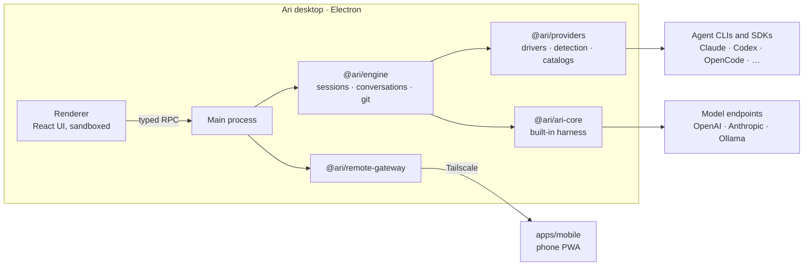

<div align="center">



# Ari

**One calm desktop for every coding agent on your machine.**

Run Claude Code, Codex, OpenCode, Grok, Qoder, Pi, Hermes, Antigravity and more side by side,<br>
review what they change, and keep them going from your phone. Local-first, no account.

[](https://github.com/j35dev/Ari/releases/latest)
[](https://github.com/j35dev/Ari/releases)
[](https://github.com/j35dev/Ari/actions/workflows/verify.yml)
[](./LICENSE)
[](https://github.com/j35dev/Ari/stargazers)
<br>
[](#install)
[](https://github.com/j35dev/Ari/issues)

[**Download**](https://github.com/j35dev/Ari/releases/latest) · [Features](#feature-tour) · [Mobile](#your-phone-as-a-remote) · [Build](#build-from-source) · [Contributing](#contributing)

</div>

<br>

<picture>
  <source media="(prefers-color-scheme: dark)" srcset="docs/images/hero-dark.webp">
  <source media="(prefers-color-scheme: light)" srcset="docs/images/hero-light.webp">
  
</picture>

<br>

Ari is an open-source **agent development environment** for Windows, macOS and Linux. It drives
the coding agents you already have installed and signed in, through their own protocols, and
gives them one place to work: a transcript you can actually read, a diff you can review, a
terminal, a browser, and a phone that stays in the loop. Its built-in harness, **Ari Core**,
turns any OpenAI-, Anthropic- or Ollama-compatible endpoint into an agent too.

> [!NOTE]
> Ari is in **beta**. Expect rough edges, and please [report them](https://github.com/j35dev/Ari/issues).

## Feature tour

<table>
  <tr>
    <td width="50%" valign="top">
      
      <p><b>Every step, readable.</b> Reads, searches, edits and commands fold into a quiet
      activity log. Open any row for the diff or the full output.</p>
    </td>
    <td width="50%" valign="top">
      
      <p><b>Agents side by side.</b> Split the stage to run Claude and Codex in parallel, and
      keep separate spaces for separate work.</p>
    </td>
  </tr>
  <tr>
    <td width="50%" valign="top">
      
      <p><b>Every model in one picker.</b> Provider, model, reasoning effort and permissions
      sit in the composer. A new session can start in its own git worktree.</p>
    </td>
    <td width="50%" valign="top">
      
      <p><b>A browser beside the chat.</b> Open your app, pick an element to mention it, or let
      the agent navigate, click and screenshot through Ari's browser tools.</p>
    </td>
  </tr>
</table>

**And the rest of the workbench:**

- **Review and ship.** A Changes panel with split or unified diffs, then commit, push and open a
  pull request from the titlebar. Pull requests and issues are listed through the GitHub CLI.
- **Files and terminals.** A file explorer with an editor, jailed to the project, and terminals
  in the side panel or in any split pane.
- **A composer that keeps up.** `@file` mentions, each provider's own `/` commands, a prompt
  stash, dictation, and steering a turn while it runs.
- **Sub-agents you can follow.** Native sub-agents and delegated child sessions get their own
  transcripts instead of a wall of nested output.
- **Machines.** Pair another computer over Tailscale and run projects, agents and terminals there.
- **Make it yours.** 15 bundled themes, custom themes, wallpapers, fonts and chat widths. The
  command palette (<kbd>Ctrl/Cmd</kbd> <kbd>K</kbd>) reaches everything.
- **Experiments.** Aria, a shared coordinator chat, is off by default; turn it on in
  **Settings → Experimental → Aria**.

## Supported agents

Ari detects every supported agent on your machine and reuses its existing sign-in. Anything
that isn't installed is simply not offered, and a provider you turn off is never launched or probed.

| Agent           | How Ari connects                   | Notes                                                                       |
| --------------- | ---------------------------------- | --------------------------------------------------------------------------- |
| **Claude Code** | Claude Agent SDK                   | Falls back to the ACP adapter, then the CLI.                                |
| **Codex**       | ACP adapter (`codex-acp`)          | Falls back to `codex app-server`, then `codex exec`.                        |
| **OpenCode**    | OpenCode server (`opencode serve`) | Classic 1.x and **OpenCode 2**; falls back to `opencode acp`, then the CLI. |
| **Grok Build**  | Native ACP (`grok agent stdio`)    | Falls back to the CLI.                                                      |
| **Qoder**       | Qoder Agent SDK                    | Falls back to its ACP mode (`--acp`). Uses your `qoder login`.              |
| **Pi**          | ACP adapter (`pi-acp`)             | Falls back to the CLI.                                                      |
| **Hermes**      | Native ACP (`hermes acp`)          | Falls back to the CLI.                                                      |
| **Muse Code**   | Native ACP (`muse acp`)            | Uses your `muse login`; upstream ACP is experimental.                       |
| **Antigravity** | Native ACP (`agy acp`)             | Gemini models. See the [integration and terms review](ANTIGRAVITY.md).      |
| **Ari Core**    | Built-in harness                   | Any OpenAI-, Anthropic- or Ollama-compatible endpoint you add.              |

Claude Code, Codex, OpenCode and Grok are on by default. Turn on the others in
**Settings → Providers**, which also has installers and an executable-path override for each.

<details>
<summary><b>Provider details</b></summary>

<br>

Native ACP providers discover their models and reasoning levels from the installed runtime.
Antigravity runs your official `agy` CLI through its
[documented ACP interface](https://antigravity.google/docs/cli/acp/) with Ari's own client
identity. Google currently limits third-party models to named ACP clients, so Ari offers Gemini
models there and refuses unsupported selections.

The ACP adapters for Claude, Codex and Pi run through `npx` at pinned versions. Each provider's
settings page shows exactly how Ari connects to it.

</details>

## Install

Download the file for your system from the [latest release](https://github.com/j35dev/Ari/releases/latest):

| System                          | File                               |
| ------------------------------- | ---------------------------------- |
| Windows 10/11 (x64)             | `Ari-Setup-<version>.exe`          |
| macOS (Apple silicon and Intel) | `Ari-<version>-universal.dmg`      |
| Linux (x64)                     | `Ari-<version>.deb` or `.AppImage` |

Ari's builds are **not signed with a paid certificate**, so each system warns you the first time:

- **Windows.** SmartScreen says "Windows protected your PC". Click **More info → Run anyway**.
  The warning is about the missing code-signing certificate, not about anything found in the installer.
- **macOS.** The app is ad-hoc signed but not notarized by Apple. Drag Ari to Applications,
  right-click it and choose **Open**. On macOS 15 and later, open it once, then use
  **System Settings → Privacy & Security → Open Anyway**. Or clear the download flag in Terminal:
  `xattr -cr /Applications/Ari.app`.
- **Linux.** Prefer the `.deb` (`sudo apt install ./Ari-<version>.deb`). The AppImage needs FUSE 2
  (`sudo apt install libfuse2`, or `libfuse2t64` on Ubuntu 24.04), and on Ubuntu 24.04 and later
  AppArmor's user-namespace restriction stops it from starting its sandbox, which the `.deb` sets up for you.

**Updates.** On Windows and Linux, Ari offers each new release and installs it when you restart.
On macOS it can't update itself: when a new version is out it links you to the release.

<details>
<summary><b>Where your data lives, and uninstalling</b></summary>

<br>

Settings, sessions, worktrees Ari creates, and in-app browser data are in the app's profile folder:

| System  | Profile folder                      |
| ------- | ----------------------------------- |
| Windows | `%APPDATA%\Ari`                     |
| macOS   | `~/Library/Application Support/Ari` |
| Linux   | `~/.config/Ari`                     |

Warnings and errors are logged to `triage/logs.jsonl` inside it; that is what
[Ari Triage](#ari-triage) reads and what `ari triage --export` packages.

To uninstall, use **Settings → Apps → Ari → Uninstall** on Windows, move `Ari.app` to the Trash
on macOS, or remove the `.deb` package (or delete the AppImage) on Linux. Uninstalling keeps your
data; to remove it too, delete the profile folder.

</details>

## Your phone as a remote

<p align="center">
  
</p>

A paired phone is a remote control for the desktop. It creates sessions, sends prompts and
follow-ups, steers and interrupts turns, and answers approvals with the provider's exact choices,
while the agents keep running on your computer. Closing the phone changes nothing about the work.

| Mode            | Setup                                                                                       | Account    |
| --------------- | ------------------------------------------------------------------------------------------- | ---------- |
| **Tailscale**   | Install Tailscale on both devices, then **Settings → Remote → Enable** and **Enable Serve** | Not needed |
| **Ari Connect** | An invitation to the hosted service, then **Settings → Remote → Managed connection**        | Required   |

With Tailscale, the desktop publishes its gateway on your tailnet and serves the phone app from
that same address, so nothing leaves your devices, and the phone can be on cellular while the
computer is on home Wi-Fi.

**Pairing.** Every device is approved at the computer, by name and a short confirmation code.
Each approval carries a project grant: a phone reaches only the projects you picked, and
revoking it is immediate. The phone's key never leaves it, because pairing stores a
non-extractable browser key, not a password.

See [`apps/mobile/README.md`](./apps/mobile/README.md) for installing the app on your phone and
for what to check when a connection fails.

## Ari Triage

When something goes wrong, Ari can investigate itself. Choose **Triage an Ari issue** from the
command palette, **Report with Triage** beside an error, or type `/ari triage <what went wrong>`
in a conversation. Review the diagnostics, pick your agent, and each case gets its own workspace.

<details>
<summary><b>How triage works</b></summary>

<br>

Triage also lives in **Settings → Advanced → Triage an issue**. Starting it from `/ari triage`
keeps the current agent, model, effort and permissions, and leaves your project conversation
intact. Add screenshots in the triage conversation after starting it.

The agent can prepare an editable issue for `j35dev/Ari`, or work on a fix in a separate source
checkout. Triage runs `pnpm verify` against the fix before it can publish a draft PR, using your
connected GitHub account and creating a contributor fork when needed. You review the public
draft, account and changes before anything is published. Installing a fixed build is a separate step.

If Ari can't start, the bundled CLI can export diagnostics or launch an installed Claude Code or
Codex on its own:

```sh
ari triage --export
ari triage --agent codex
ari triage --agent claude --profile /path/to/affected/Ari/profile
```

When the `ari` launcher isn't on your PATH, run the same commands with Node against the installed
`resources/agent-cli/ari.cjs`. Terminal agent launches exclude logs by default; diagnostic exports
include recent sanitized warnings and errors.

</details>

## Privacy

Ari has **no telemetry or analytics SDK** and needs no account. It talks to the network for what
you use (your agents, the model endpoints you add, the phone connection) plus a few background
checks: GitHub for Ari updates, models.dev for model lists, and the npm registry for agent CLI versions.

Discord Rich Presence is **on by default**: with the Discord desktop app running it shows
"Running N agents" or "Idle" and how long Ari has been open, nothing about your projects. Turn it
off in **Settings → Notifications → Discord status**.

## Build from source

### Quick start

You need **Node ≥ 22.13** and **pnpm**. The lockfile is pinned to the version in
`packageManager`, so `corepack enable` picks the right one.

```sh
git clone https://github.com/j35dev/Ari.git
cd Ari
pnpm install   # electron and esbuild fetch their binaries; no approve-builds step needed
pnpm dev       # starts "Ari Dev"
```

`pnpm dev` runs as **Ari Dev** with its own profile (Windows: `%APPDATA%\Ari Dev`), so it can sit
next to an installed Ari; sessions and settings are not shared. On first launch, point it at a
project folder and start a session.

<details>
<summary><b>Packaging installers</b></summary>

<br>

Installers are built with [electron-builder](https://www.electron.build); the config is
[`apps/desktop/electron-builder.yml`](./apps/desktop/electron-builder.yml). From the repo root:

```sh
pnpm install
pnpm --filter @ari/desktop build             # renderer + main bundles
pnpm --filter @ari/mobile build              # phone PWA, packed into the installer
cd apps/desktop
pnpm exec electron-builder --win --x64       # NSIS installer → dist/Ari-Setup-<version>.exe
pnpm exec electron-builder --mac             # universal DMG   (needs macOS)
pnpm exec electron-builder --linux --x64     # AppImage + deb  (needs Linux)
```

`pnpm-workspace.yaml` already allows the packages that need install scripts (`electron`,
`esbuild`, `electron-winstaller`), and the terminal's pty comes from `@lydell/node-pty`
prebuilds. Native modules use the locked Node-API prebuilds: don't run `install-app-deps` or
override the configuration's disabled native rebuild.

Windows builds are unsigned unless `CSC_LINK` / `CSC_KEY_PASSWORD` are set; macOS builds are
ad-hoc signed and not notarized. Before a release, regenerate the bundled license notices with
`node scripts/third-party-notices.mjs`.

</details>

### Architecture



A pnpm monorepo of small, strict packages:

| Package                                     | Role                                                                           |
| ------------------------------------------- | ------------------------------------------------------------------------------ |
| `@ari/contracts`                            | Zod schemas and typed RPC channels: parse once at the boundary                 |
| `@ari/shared`                               | Result types, JSONL utilities, logger                                          |
| `@ari/ui`                                   | Design system: tokens, primitives, motion, themes                              |
| `@ari/providers`                            | Driver registry: SDK, ACP and CLI transports, detection, model catalogs        |
| `@ari/engine`                               | Sessions, SQLite conversation store, git service (diffs, worktrees)            |
| `@ari/ari-core`                             | The built-in harness for any OpenAI-, Anthropic- or Ollama-compatible endpoint |
| `@ari/remote-gateway`, `@ari/remote-client` | The phone connection: pairing, grants, the wire protocol                       |
| `apps/desktop`                              | The Electron shell: sandboxed renderer, typed IPC, React UI                    |
| `apps/mobile`                               | The installable phone PWA                                                      |

A few invariants worth knowing before you dig in:

- **Events in, state out.** Agent output arrives as typed events that are folded into
  conversations and saved in SQLite, so a transcript opens from its saved messages instead of
  replaying every event.
- **The renderer is sandboxed.** Every privileged operation is a typed RPC handled in the main
  process; the file explorer and editor are jailed to the workspace.
- **One driver per agent.** Adding an agent means implementing one driver; detection, transport
  and the model catalog slot in around it.

### Development

```sh
pnpm dev          # the desktop app in dev mode
pnpm verify       # typecheck + lint + test across the workspace (run before every commit)
pnpm test:watch   # vitest in watch mode
pnpm format       # prettier
```

## FAQ

<details>
<summary><b>Does Ari need its own account or API key?</b></summary>
<br>
No. Ari drives the agents you have already installed and signed in to, with their own logins
and subscriptions. Ari Core uses only the endpoints and keys you add yourself.
</details>

<details>
<summary><b>Which agents do I need to install?</b></summary>
<br>
Any of the <a href="#supported-agents">supported agents</a>. Ari detects what's on your machine
and offers only those; optional providers can be installed from <b>Settings → Providers</b>.
</details>

<details>
<summary><b>Why does my system warn me when I install it?</b></summary>
<br>
The builds aren't signed with a paid certificate. See <a href="#install">Install</a> for the
one-time steps on each system.
</details>

<details>
<summary><b>Does my code leave my machine?</b></summary>
<br>
Only through the agents and endpoints you choose to use. Ari has no telemetry, and the phone
connection over Tailscale stays on your own tailnet. See <a href="#privacy">Privacy</a>.
</details>

<details>
<summary><b>Can I run a development build next to the installed app?</b></summary>
<br>
Yes. <code>pnpm dev</code> runs as <b>Ari Dev</b> with a separate profile, so the two never share
sessions or settings.
</details>

<details>
<summary><b>Something broke. What should I send?</b></summary>
<br>
Use <a href="#ari-triage">Ari Triage</a>, or attach the output of <code>ari triage --export</code>
to a <a href="https://github.com/j35dev/Ari/issues">GitHub issue</a>.
</details>

## Star history

<a href="https://www.star-history.com/#j35dev/Ari&Date">
  <picture>
    <source media="(prefers-color-scheme: dark)" srcset="https://api.star-history.com/svg?repos=j35dev/Ari&type=Date&theme=dark">
    <source media="(prefers-color-scheme: light)" srcset="https://api.star-history.com/svg?repos=j35dev/Ari&type=Date">
    
  </picture>
</a>

A star genuinely helps: it is how new people find Ari while it is still moving fast.

## Contributors

<table>
  <tr>
    <td align="center" width="120">
      <a href="https://github.com/j35dev"><br><sub><b>j35dev</b></sub></a><br><sub>Maintainer</sub>
    </td>
    <td align="center" width="120">
      <a href="https://github.com/jdholst"><br><sub><b>jdholst</b></sub></a>
    </td>
    <td align="center" width="120">
      <a href="https://github.com/aryamthecodebreaker"><br><sub><b>aryamthecodebreaker</b></sub></a>
    </td>
    <td align="center" width="120">
      <a href="https://github.com/claude"><br><sub><b>Claude</b></sub></a><br><sub>by Anthropic</sub>
    </td>
  </tr>
</table>

### Contributing

Issues and pull requests are welcome; see [CONTRIBUTING.md](./CONTRIBUTING.md). For substantial
changes, open an issue first to agree on the scope. Keep diffs small, match the existing style,
and make sure `pnpm verify` is green before you push.

## License

[MIT](./LICENSE). Ari ships third-party packages under their own licenses, listed in
[`THIRD_PARTY_NOTICES.txt`](./THIRD_PARTY_NOTICES.txt) (also in the app's `resources` folder).
