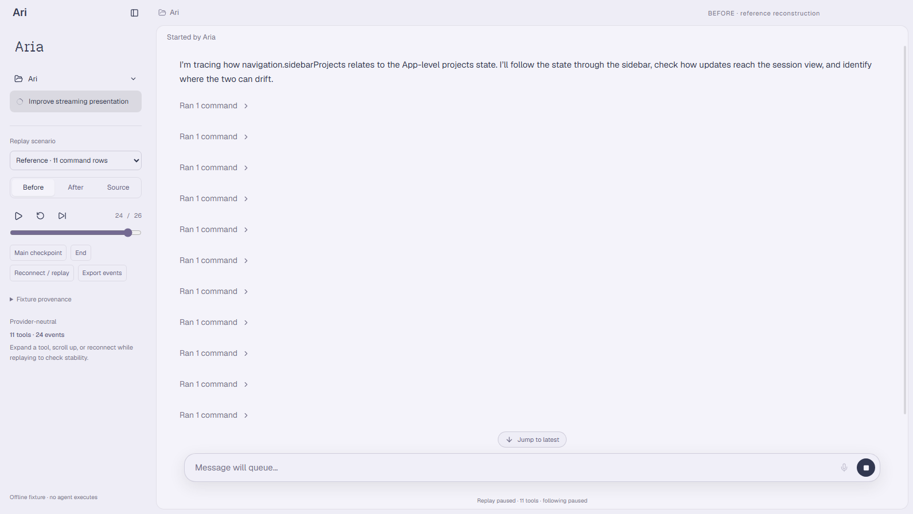
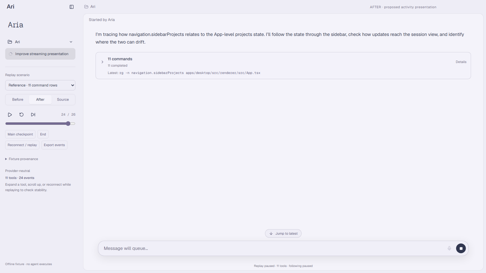
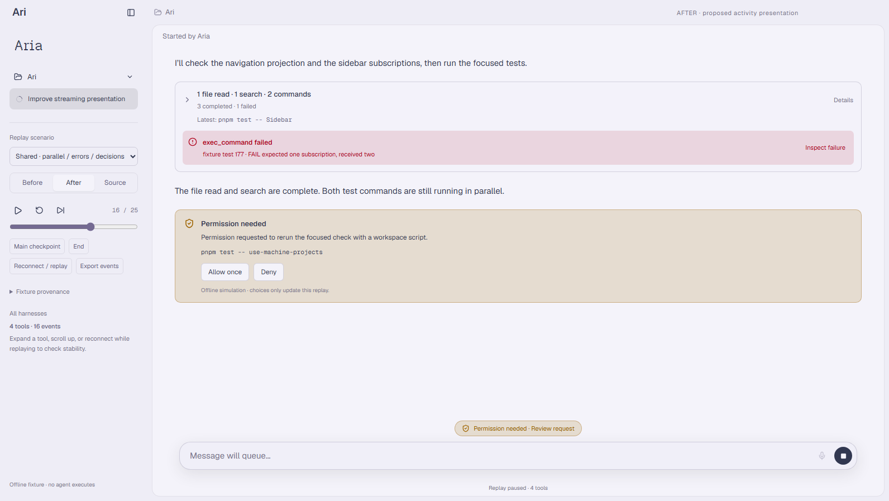

# Ari streaming presentation review

Replace the expanding stream of routine tool rows with a stable activity group, while preserving narration, exact commands and outputs, and visible failures and decisions. This is a presentation and event-contract proposal across **all nine registered harness kinds and all their supported transports**, not a provider speed investigation.

Reviewed source: `a0a2c52a58f39e8421663ed733c488bab4145276`, 22 November 2026. Assignment ran with **GPT-6.1-Sol, xhigh effort, full permissions**. No agents were spawned. Production parser, engine, chat renderer, shell, themes and composer are unchanged. The only existing file changed is the desktop TypeScript include list, to typecheck the isolated preview configuration.

## See the comparison





Both images use the **same 24-event prefix of a 26-event fixture**: one narration paragraph and eleven completed command calls. The before image faithfully reconstructs the described failure: light lavender Ari context, “Started by Aria,” narration near x312, eleven separate “Ran 1 command” chevron rows, “Jump to latest,” and the existing rounded queue composer/stop control. Reconstructed row cadence is 54px, close to the described roughly 60px. The after presents those eleven calls in **one activity group**, with the exact count, completion tally and latest command. No output or tool was removed from the fixture. Neither image is a capture of a live provider run.

The screenshot itself was not supplied to this isolated session; its description was. The lavender palette and static sidebar are approximations scoped to the preview. Existing Ari **Titlebar, Geist/Geist Mono fonts, MarkdownBlock, ToolCallDetails and Composer** are reused. A third **Source** view mounts the existing `TranscriptView`, to avoid implying that the reconstruction is the inevitable result of today's renderer. Source adapts the same sequence to representable production message parts; proposed progress/snapshot/decision fields cannot all be represented by that old contract.



More previews: [expanded exact command](previews/03-expanded-command-1592x897.png), [existing source renderer](previews/04-current-source-1592x897.png), [bounded 180-line output](previews/06-bounded-output-1592x897.png), [two active tools](previews/07-parallel-running-1592x897.png), [connection lost](previews/08-disconnected-1592x897.png), [960px](previews/09-narrow-960x760.png), [640px](previews/10-narrow-640x760.png), [Pi before](previews/11-pi-before-1592x897.png), [Pi after](previews/11-pi-after-1592x897.png), [OpenCode before](previews/12-opencode-before-1592x897.png), [OpenCode after](previews/12-opencode-after-1592x897.png). Pi/OpenCode pairs also share their exact event sequence and checkpoint. There are fourteen PNGs; all desktop images are 1592×897 at device scale 1.

## Run the interactive replay

From the repository root:

```powershell
pnpm install --frozen-lockfile --ignore-scripts
pnpm --filter @ari/desktop exec vite --config streaming-fixture.config.ts
```

Open **http://127.0.0.1:5317/testing/streaming.html?view=after&scenario=reference**. The fixture is currently served there in this session. It does not boot Electron main, call a gateway, run commands, publish anything, or operate a real session. The fixture replaces the preload bridge with a local refusal stub. Composer sends only update a local notice; Stop pauses replay. Approval/question buttons are labelled simulations.

Controls: select one of 21 scenarios; switch Before / After / Source at the same cursor; Play, Pause, Reset, Next event, scrub, Main checkpoint, End, Reconnect/replay. Expand activity, individual tools and output. Copy exact/Save preserve the source output string. Export events downloads all currently delivered fixture events, including chunks and replaced snapshots, so the full sequence remains inspectable. “Raw output” preserves control sequences; the readable view strips ANSI and resolves simple carriage-return progress. The latter is not a terminal emulator.

Useful direct links:

- `?view=after&scenario=stress&at=11`: two simultaneous active commands.
- `?view=after&scenario=stress&at=16`: completed checks, failure, permission request.
- `?view=after&scenario=stress&at=19`: disconnected, pending retry remains pending.
- `?view=after&scenario=stress&at=22`: question requiring a decision.
- `?view=after&scenario=stress&at=25`: explicit cancellation.
- `?view=after&scenario=reference&details=open`: expanded tool list.

`apps/desktop/streaming-fixture.config.ts` builds with `pnpm --filter @ari/desktop exec vite build --config streaming-fixture.config.ts`; output is `apps/desktop/out/streaming-fixture/testing/streaming.html` plus assets. The normal app entry point never imports this fixture.

PNG capture/check driver: `apps/desktop/src/renderer/testing/streaming/capture.cjs`. With the fixture server running, launch that file with an installed Electron runtime. On this machine the runtime used was `D:/Projects/Ari/node_modules/.pnpm/electron@43.4.1/node_modules/electron/dist/electron.exe`. Start it with PowerShell `Start-Process -WindowStyle Hidden -Wait`, passing the absolute capture script path. It creates a hidden native Electron fixture window with isolated userData under `apps/desktop/out/streaming-capture-profile`; it never loads Ari main or touches the live coordinator. PNGs and machine-readable checks are written to this document's `previews` directory.

## Coverage: actual registered harnesses and routes

The authoritative enum is [common.ts](../../../packages/contracts/src/common.ts) (`driverKindSchema`, line 12). Registration is [rpc.ts](../../../apps/desktop/src/main/rpc.ts) (`hydrateDrivers`, line 962; Ari Core at 1235). [launches.ts](../../../packages/providers/src/acp/launches.ts) defines adapter pins and native ACP commands. Registration depends on the installed binary and settings; this table enumerates **all eligible kinds**, not a claim that all are installed or authenticated on this machine.

| Harness | Production route and compatibility paths | Source and replay coverage |
| --- | --- | --- |
| Claude | Agent SDK primary; ACP compatibility; stream-json CLI rollback/fallback. Existing live transport is reused. | `claude/claude-driver.ts`, `cli-driver.ts`, `mapper.ts`; synthetic SDK/CLI messages through `ClaudeMessageMapper`; ACP updates through `AcpUpdateFolder`. |
| Codex | ACP adapter (`@agentclientprotocol/codex-acp@1.7.0`); fallback `CodexDriver` probes app-server, then exec JSON. | `codex/codex-driver.ts`, `mapper.ts`, app-server connection/correlation tests; ACP and exec fixtures; app-server UI stress sequence is synthetic normalized data, not a native invocation. |
| OpenCode | Native `opencode acp --print-logs --log-level ERROR`; run JSON fallback. | `opencode/mapper.ts`, `opencode-driver.ts`, shared ACP folder; recorded repository hello run plus explicitly synthesized tool states; ACP and stress previews. |
| Pi | `pi-acp@0.0.33`; JSON CLI fallback. | `pi/mapper.ts`, `pi-driver.ts`, shared ACP folder; existing synthesized success fixture through the real legacy mapper, and synthetic ACP updates. |
| Grok | Native `grok agent stdio` ACP; Anthropic-style streaming-messages NDJSON fallback. | `grok/mapper.ts`, `grok-driver.ts`; synthetic partial message through mapper and ACP/stress sequences. |
| Hermes | Native `hermes acp`; legacy stream-json fallback. | `hermes/mapper.ts`, `hermes-driver.ts`; synthetic mapper input and ACP/stress sequences. Legacy schema is expressly unverified in its source. |
| Qoder | Native `qoder --acp`, ACP only. | ACP folder, launches and requests; synthetic ACP + shared stress fixture. No fabricated CLI fallback. |
| Muse | Native `muse acp`, ACP only. | ACP folder, launches and requests; synthetic ACP + shared stress fixture. No fabricated CLI fallback. |
| Ari Core | Direct OpenAI-compatible chat completions, Anthropic Messages, Ollama. | `ari-core-driver.ts`, `agent-loop.ts`, all three `protocols/` streamers; protocol/loop tests; three synthetic UI stress scenarios. |

Pi/OpenCode and other harnesses may offer many upstream model providers. Those models follow the **selected harness's transport and shared event boundary**, not a separate React renderer. Custom/remote OpenAI-compatible endpoints use the same Ari Core OpenAI chat streamer. There are no separate registered Gemini/Copilot harness kinds in this revision. Adding future kinds should require the same conformance suite; the UI must not branch on model vendor.

## Source-backed diagnosis

These findings describe this checkout. The ten regression-style audit tests deliberately assert current behavior in [source-audit.test.ts](../../../apps/desktop/src/renderer/testing/streaming/source-audit.test.ts); they document problems without changing production.

1. **Grouping already exists.** [groupBlocks.ts](../../../apps/desktop/src/renderer/src/features/transcript/groupBlocks.ts) groups consecutive tool calls/results and thinking; assistant prose breaks the run. It uses the first block for a stable key. [splitBlocks.ts](../../../apps/desktop/src/renderer/src/features/transcript/splitBlocks.ts) merges adjacent streamed text within a message. Eleven consecutive routine calls alone produce one group today. Empty markdown blocks split groups despite showing no prose; tool-only runs from different turns are currently allowed to merge because the main grouping loop does not check turn IDs. Both cases are reproduced by tests. The precise cause/version/transcript behind the reported eleven-row screen is **unconfirmed**.

2. **Live layout and history optimize different things.** [ActivityBurst.tsx](../../../apps/desktop/src/renderer/src/features/transcript/ActivityBurst.tsx) sets `open = openOverride ?? (terminal || live)`, so a live group opens its step list automatically. Thinking steps can also appear there; this proposal never displays hidden reasoning. Completed groups fold after a 300ms hold. The file explicitly keeps tool-result errors folded and omits error counts from the headline. A failed tool can therefore be invisible in collapsed history. [TranscriptView.tsx](../../../apps/desktop/src/renderer/src/features/transcript/TranscriptView.tsx), `activeIndex` near 224, marks only the last eligible row active. Narration arriving after parallel starts changes which row is live even while earlier calls are still unanswered. `ActivityStep` determines pending state solely by result presence.

3. **The normalized contract loses information needed for a coherent stream.** [agent-event.ts](../../../packages/contracts/src/agent-event.ts) has anonymous `text-delta`/`thinking-delta` plus tool started/completed; no tool progress/output delta, source narration item identity, append-versus-snapshot mode or per-tool cancelled/unknown outcome. Approval events do retain exact offered option IDs, and those must be preserved. [message.ts](../../../packages/contracts/src/message.ts), `pushMessageParts`, replaces repeated tool starts by call ID but appends repeated results. This handles argument refinement, not general event idempotency.

4. **Compatibility transports have concrete losses and status errors.** [pi/mapper.ts](../../../packages/providers/src/pi/mapper.ts) deliberately ignores `message_update` and does not map `tool_execution_update`; narration arrives at `message_end`, outputs at tool end. [opencode/mapper.ts](../../../packages/providers/src/opencode/mapper.ts), `mapToolPart`, returns early only for `pending`; a `running` state emits `tool-completed` with partial output. Both behaviors are verified by audit tests. They do not prove Pi/OpenCode ACP has those same bugs.

5. **ACP progress is not accumulated and completion deduplication is incomplete.** [acp/protocol.ts](../../../packages/providers/src/acp/protocol.ts), `AcpUpdateFolder` near 357, refines name/input and handles completion-only tools. However, `OpenCall` retains no output/content; a nonterminal output followed by completion without output becomes `[]`. A repeated terminal update emits another completion. Both are tested. `resultJsonOf` prefers raw output, otherwise reduces content to text/diffs; terminal/resource content and locations are not preserved as typed display data. Cancellation currently reaches `done` rather than a per-tool cancelled outcome. [acp/client-requests.ts](../../../packages/providers/src/acp/client-requests.ts) owns filesystem/terminal/permission/input requests; presentation should retain meaningful terminal IDs, truncation and exit data instead of exposing arbitrary protocol chatter as assistant prose.

6. **Codex and Claude differ in snapshot reconciliation.** [codex/mapper.ts](../../../packages/providers/src/codex/mapper.ts), `notificationEvents` near 556, maps text deltas but drops `item/commandExecution/outputDelta`. Its complete text fallback is suppressed after *any* delta for that item. A `hel` partial followed by a `hello` final emits only `hel` in the audit fixture; normal full-delta delivery is not asserted to truncate. [claude/mapper.ts](../../../packages/providers/src/claude/mapper.ts), `ClaudeMessageMapper` near 393, tracks streamed content and computes finalized remainders, deduplicates starts, and handles provider notices separately. This is a useful existing pattern to extend, not replace with generic text deduplication.

7. **The engine preserves many ordering invariants, but cannot recover stripped semantics.** [engine.ts](../../../apps/desktop/src/main/engine.ts) actually uses **50ms** `TEXT_FLUSH_MS` at line 49; older comments mention ~120ms. Text/thinking are buffered and flushed before tool traffic; `callMessageIds` anchors refinements/results to the originating message, then removes ownership on completion. A repeated completion after a message split can land on a newer message. The `error` branch near 1675 appends an error without first flushing buffered narration, unlike tool/notice branches; pending text could consequently be journaled after the error. That ordering consequence is a **source-derived risk**, not a captured live failure in this review. The generic [process-stream.ts](../../../packages/providers/src/process-stream.ts) correctly buffers partial JSONL lines until newline, but does not parse the last buffer on close; a final JSON record without newline is lost in the audit test. Stderr is normally logging/tail diagnostics, not normal chat activity; raw ANSI is not universally being rendered as narration.

8. **Replay/scroll infrastructure should be retained.** [journal.ts](../../../packages/engine/src/journal.ts) persists ordered events with default per-append fsync. [projection.ts](../../../packages/engine/src/projection.ts) and the renderer [message-fold.ts](../../../apps/desktop/src/renderer/src/features/session/message-fold.ts) use shared part folding. [history-journal.ts](../../../apps/desktop/src/renderer/src/features/session/history-journal.ts) deduplicates by journal sequence and rebuilds for recovered earlier gaps. `SessionView` buffers live frames behind replay barriers and rejects stale attempts; history tests exercise recovery without replaying attention chimes. `TranscriptView` follows the tail through `ResizeObserver`, turns following off on scroll-up and restores offsets for hidden panes. These safeguards are already present; row expansion/collapse, rich output sizing and newly mounted lazy placeholders remain potential layout triggers. It would be incorrect to diagnose an absence of scroll or reconnect handling.

9. **Output and count presentation are not uniformly semantic.** [ToolResultBody.tsx](../../../apps/desktop/src/renderer/src/features/transcript/ToolResultBody.tsx) already bounds output (160px collapsed / 480px expanded), preserves copy, and supports diffs/MCP images. Parsed strings are passed through JSON stringification, so terminal text can look like quoted escaped JSON. It is not an ANSI terminal view. `summarizeToolRun` in `groupBlocks.ts` defaults unknown calls to “commands”; read/search counts are calls, edit counts deduplicate lowercased paths. A shell `rg` or `Get-Content` does not justify separately counting files read/searches without explicit metadata. The prototype counts declared operation kinds, uses “file reads” for operations rather than distinct files, and has an “other tools” bucket.

## Recommended event and UI changes

**Keep the durable journal as the authority; add a lossless operation projection before presentation.** Scope operation keys by session, provider thread/turn and call/item ID. Retain first-start sequence and stable narration item IDs, source version/receipt identity, transport provenance and typed payloads. A start, argument refinement, output delta, output snapshot and terminal update must update one operation, not each become a row. Snapshot replacement and delta append are explicit modes. Treat repeated same-source completions idempotently. If only completion is known, display “start not observed”; never fabricate duration or a running interval. On local interruption mark outstanding calls cancelled; on unknown disconnect keep outcome unknown/pending. A provider's `done` alone does not prove every unpaired tool succeeded.

**Use one compact activity group for consecutive routine operation starts.** End groups at visible narration, user messages, turn/provider boundaries, approvals, questions, explicit notices or native-child handoff. Argument/output/completion updates stay attached to the original group even after later narration arrives. Parallel calls share a group but show their own independent status. The collapsed row holds actual operation counts, running/completed/failed/cancelled/unknown tallies, and current actions from explicit tool name/arguments/provider title. It stays collapsed while streaming unless the reader opens it. Do not fold substantive prose into a guessed summary or deduplicate ordinary repeated narration by matching strings.

**Make failures and decisions visible without expanding routine activity.** Show a failure summary from an explicit provider error field when available, otherwise an honest failure status and inspect action. Do not extract arbitrary “error-looking” log lines as truth in production: the fixture uses a synthetic FAIL line solely to demonstrate the layout. Keep permission options with native IDs and exact scopes, and questions in the existing actionable attention system. The prototype also keeps a pending-decision link above the composer, so expanding long output cannot hide that a response is needed. Historical controls must not regain authority merely through replay. Native children, model switches, compaction, rich resources and provider-specific notices retain their existing meaningful views and source metadata.

**Keep details complete and bounded.** The expanded group shows every operation in first-start order; completion order is separate information, not a new transcript order. Each call reveals exact arguments, typed output/exit/truncation/resource information and source IDs. Default to a short readable tail or preview, with bounded full expansion, Copy exact, Save output and access to raw event versions. Preserve all raw outputs in the underlying journal; readable ANSI/CR rendering is a derived view. Retain Ari's existing multimodal/diff viewers, not just the text-only prototype well.

**Make following a reader-controlled state.** Follow only while pinned. Scroll-up and explicit expansion pause following before the DOM grows; keep the composer fixed and show “Jump to latest” with unseen activity. Replay should apply data without new-run entrances/chimes or closing the reader's expanded details. Before production rollout, preserve a visible row/offset anchor when earlier expanded output grows, and feed measured expanded heights to lazy-row estimates. The prototype verifies numeric scroll position through the tested scroll-up/next-event path; it is not a complete long-history anchor/virtualizer implementation.

## Checks and limits

- **24 new tests**: 14 projection invariants and 10 current-source edge-case reproductions. The latter intentionally pass while documenting production defects.
- **322 existing tests** passed across provider mapping/requests/app-server (146), Ari Core protocol/concurrency (41), engine journal/projection (36), transcript folding/grouping/pinning/store (67), and session history/provider-switch recovery (32). Total: **346 passing tests** in selected suites. No live model or authenticated provider was invoked.
- Desktop TypeScript, fixture ESLint and formatting checks passed. Vite fixture production build passed; it reports the existing imported Markdown/highlighter bundle exceeding the 500kB chunk advisory. This is not a production-wide build/performance claim.
- Native capture driver: 14 screenshots, all 21 scenarios rendered, no renderer errors. Verified before/after tool identity and cursor equality, expansion, output presence and bounding, replay duplication, two active tools, disconnect status, simulated approval resolution, play/pause/reset/step, scroll-up retention and document width at 960/640px. [capture-checks.json](previews/capture-checks.json) records snapshots and dimensions.
- Visual inspection used Ari's assigned in-app browser plus the saved native fixture PNGs. Browser interaction also exercised expanding long output, reconnect and a fixture-only composer send. The live coordinator and other project's drag-reorder session were not modified or navigated via `ari app open`.
- The reference image is reconstructed, not captured. Pi success and Hermes legacy success fixtures are documented as synthesized in repository source; OpenCode's recorded fixture contains a hello run, not the eleven-row failure. ACP/stress sequences are synthetic, and UI coverage is not equivalent to end-to-end integration against every installed harness/version. Native child UI, full rich output, true byte-stream reconnect, provider callback restoration and long-session virtualization remain outside this review prototype.

Review the **event contract and presentation behavior together** before shipping. Fixing only a Pi/OpenCode renderer branch would miss the shared lifecycle, normalization and layout issues, while changing only adapters would leave the automatically expanding live step list and hidden failures intact.
