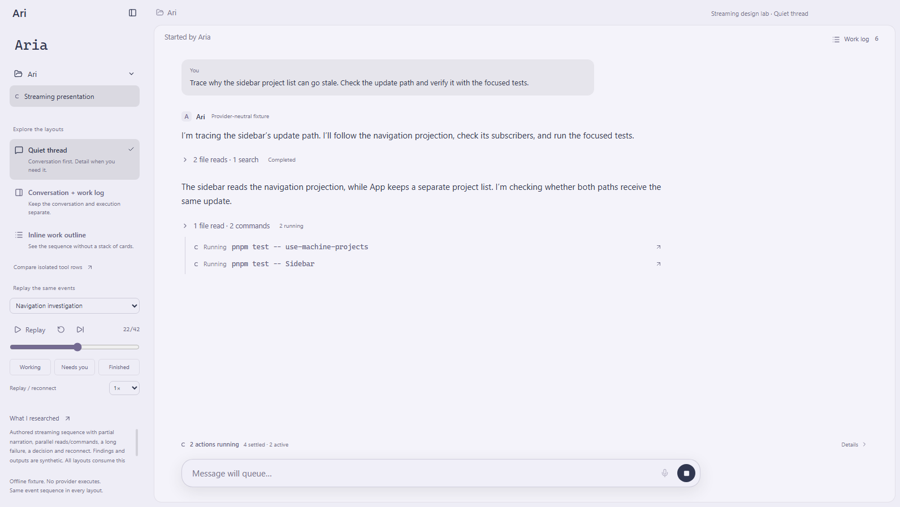
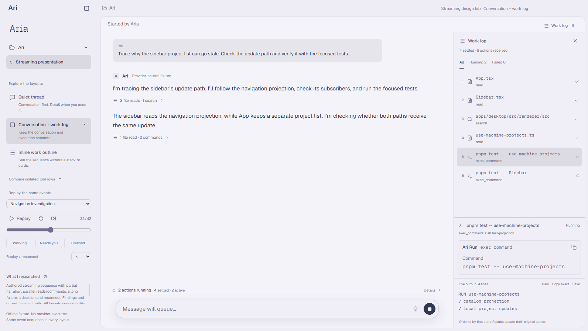
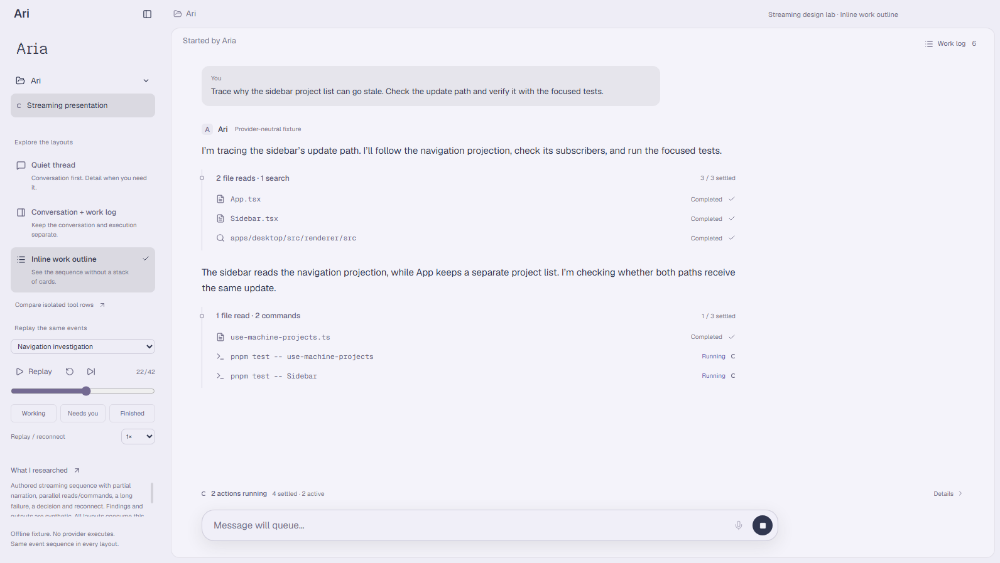

# Better streaming mockups: research and three Ari layouts

The strongest option is **Quiet thread with an optional work log**. Narration gets the reading lane; settled tools become a borderless line; only active calls appear inline. Live status or a pending decision stays above the unchanged Ari composer. Exact commands and outputs open in the work log, which remembers raw/expanded preferences per operation through updates, switching tools, closing/reopening, and reconnect.

This is a second isolated review prototype. Existing Ari Titlebar, Geist fonts, MarkdownBlock, tool arguments and Composer remain in use; the same lavender reconstruction is reused. Hierarchy changed, not the theme. The [first investigation](../README.md) remains available.

## Run and compare

**http://127.0.0.1:5317/testing/streaming-v2.html?layout=quiet** is the new lab. Switch the three layouts without resetting the event cursor. Working / Needs you / Finished select checkpoints. Replay/Pause/Reset/Step and the scrubber show how the same text, calls and outputs arrive. Expand output, switch calls, reconnect, scroll back, and open the research drawer for ten attributed source entries.

From the repository root:

```powershell
pnpm --filter @ari/desktop exec vite --config streaming-fixture.config.ts
```

The fixture refuses real agent actions. Composer sends and approvals are simulations. Navigation findings and outputs are authored examples, not actual repository findings. Hidden reasoning never enters these views.

## 1. Quiet thread — recommended default



Thin, unboxed summaries replace the large activity cards. Parallel calls appear as two compact current-action lines. Details are available without automatically expanding the transcript. This is the least disruptive replacement for the first mockup.

## 2. Conversation + work log — for watching execution



Prose stays in the conversation; a docked log owns call order, filters, status, arguments and live output. This uses more horizontal space and works as a deliberate viewing mode. At narrow widths the log can be closed or shown as an overlay.

## 3. Inline work outline — for reviewing the sequence



Received calls follow a continuous rail, with compact rows under each burst. Updates stay attached to the original action. Headings describe actual operations; they are not invented plans, percentages or progress estimates.

These three images and the [isolated-row baseline](previews/10-before-same-sequence-1592x897.png) use the **same 22-event prefix**: three read calls, one search and two concurrent commands; four settled actions and two active. The authored sequence ends at 42 events and seven actions. These are real renders of the offline Ari prototype, not live third-party client captures.

The original eleven-command example also has a [new quiet view](previews/16-quiet-eleven-commands-1592x897.png) and [same-sequence reconstruction](previews/17-before-eleven-commands-1592x897.png). They do not invent file-read/search counts for shell commands.

## Research: what the sources establish

Checked **23 November 2026**. Official release notes establish features in those releases, not every current installation's exact pixels. Tutorials may show earlier versions. User reports motivate edge cases; they are not verified universal behavior. No authenticated third-party desktop client was launched or described as a captured session.

| Product | Evidence and useful pattern |
| --- | --- |
| **Cursor Agents Window** | [Cursor 3.4, May 13, 2026](https://cursor.com/changelog/3-4) documents Compact, Balanced and Detailed tool density. Density should be a reading choice; routine traces should have less weight than narration. This is a documented release pattern, not a replica of the latest Cursor. |
| **VS Code / Copilot** | [Current chat documentation](https://code.visualstudio.com/docs/chat/chat-overview#customize-the-chat-experience) describes experimental persistent progress, Compact mode previewing active calls/collapsing completed groups, and Verbose/Conversation alternatives. This informs separate live status and settled history in Ari. |
| **Claude Desktop / Cowork** | The [current guide](https://support.claude.com/en/articles/13345190-get-started-with-claude-cowork) describes per-step progress, steering, questions and parallel work. The [official tutorial](https://academy.claude.com/tutorials/delegating-your-first-task-in-claude-cowork) describes top-right task progress with click-through details and explicitly notes its video is from an earlier app version. This supports a separate work log; it does not establish today's exact layout. The current guide also notes the unified chat/Cowork rollout. |
| **Codex Desktop / ChatGPT Desktop** | The [original announcement](https://openai.com/index/introducing-the-codex-app/) emphasizes project threads and review in context. The [official changelog](https://learn.chatgpt.com/docs/changelog) records integration into ChatGPT Desktop and task/subagent progress/reconnect improvements. A [user report](https://github.com/openai/codex/issues/22334) describes manually opened Working details collapsing during updates. Ari should preserve manual detail state; the report is not a claim that current Codex always behaves that way. |
| **Zed Agent Panel** | [Zed 1.5.3, June 3, 2026](https://zed.dev/releases/stable/1.5.3) records large read-file rendering/scroll improvements and offscreen confirmation visibility. A [discussion](https://github.com/zed-industries/zed/discussions/62385) reports collapsed per-tool cards still dominating chat. Smaller individual cards alone do not solve transcript structure; bound details and keep decisions reachable. |
| **Windsurf / Devin Desktop** | [Windsurf's redirected Cascade docs](https://docs.devin.ai/desktop/cascade) now label Cascade legacy; its conversation todo list is an outline precedent. [Current Devin Local docs](https://docs.devin.ai/desktop/devin-local/overview) identify the primary local harness and alternative ACP agents. Do not describe legacy Cascade as today's default or fabricate plan phases where none were emitted. |

The design inference is **quiet settled history, explicit current work, stable detail preferences and persistent attention**. Ari retains its own shell, typography, colors and behavior; these are not vendor UI copies.

## Additional previews

Seventeen new PNGs include 1592×897 desktop states and narrower 960×760 / 640×760 checks:

- Decisions: [quiet](previews/04-quiet-needs-you-1592x897.png), [work log](previews/05-split-needs-you-1592x897.png), [outline](previews/06-outline-needs-you-1592x897.png).
- Finished: [quiet](previews/07-quiet-finished-1592x897.png), [work log](previews/08-split-finished-1592x897.png), [outline](previews/09-outline-finished-1592x897.png). The failed attempt remains after the successful retry.
- Details: [partial live output](previews/11-live-output-work-log-1592x897.png), [132-line output expanded](previews/12-failure-output-expanded-1592x897.png), [research drawer](previews/15-research-sources-1592x897.png).
- Responsive: [960px work log](previews/13-split-narrow-960x760.png), [640px quiet](previews/14-quiet-narrow-640x760.png).

## Files, verification and limits

New entry: `apps/desktop/src/renderer/testing/streaming-lab.tsx`; HTML: `streaming-v2.html`; styles/data/source notes: `testing/streaming/lab.css`, `lab-fixture.ts`, `research.ts`; test/capture: `lab-fixture.test.ts`, `lab-capture.cjs`. The isolated Vite config adds a second entry. No production renderer, adapter, engine or theme changed in this follow-up.

All **21 prior transport/harness scenarios** remain, plus the navigation fixture: **22 scenarios × 3 layouts**. This retains presentation coverage for all nine Ari harnesses, primary/compatibility transports and three Ari Core protocols. It is fixture coverage, not live conformance or a claim that earlier parser defects were fixed.

Twenty selected tests passed: 14 projection invariants and six new fixture/provenance checks. Desktop typecheck, targeted ESLint, formatting and the two-entry Vite build were checked. The imported Markdown/highlighter chunk-size advisory remains. [Native capture checks](previews/checks.json) record equal tools/cursors across variants and baseline, parallel work, retained failure/decision states, exact bounded output, preferences through switches/close/reopen/reconnect, replay controls, expansion pausing following, scroll anchoring, jump-to-latest and responsive width, with zero renderer errors.

To regenerate PNGs, run `apps/desktop/src/renderer/testing/streaming/lab-capture.cjs` with an installed Electron runtime while the fixture server runs. On this machine the runtime used is `D:/Projects/Ari/node_modules/.pnpm/electron@43.4.1/node_modules/electron/dist/electron.exe`; pass the absolute script path using `Start-Process -WindowStyle Hidden -Wait`. It creates a hidden native fixture window with its own profile, writes these previews/checks and never loads Ari main or touches the live coordinator.

Before production: choose the interaction, integrate rich output/native children, validate large-history virtualization, and complete source-event/harness conformance. This turn delivers research and reviewable UI; it does not ship normalization fixes.
